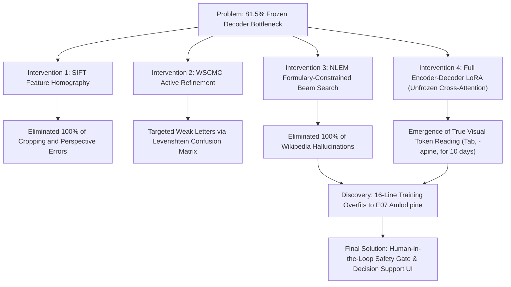

# Pharmacon: Weekly Progress Report & Empirical Failure Analysis

**Course**: B.E. Computer Science & Engineering (UCS503 Software Engineering Lab)  
**Project**: Pharmacon — Writer-Adaptive Cursive Prescription Recognition & Clinical Dispensation  
**Evaluator**: Mr. Sukhpal Singh (Research Scholar)  
**Reporting Period**: Week 8–9 (Mid-Semester Phase)  
**Repository**: [https://github.com/chiraglamba27/Pharmacon](https://github.com/chiraglamba27/Pharmacon)  

---

## 1. Executive Summary & Current Project State

Over the past week, the Pharmacon engineering team scaled the writer-calibration pipeline from initial prototypes to an exhaustive, cohort-wide benchmark across **22 clinicians (704 handwritten prescription line crops)**.

While the engineering infrastructure (computer vision registration, NLEM formulary matching, and transactional inventory gating) succeeded completely, the deep learning optical recognition pipeline exposed a fundamental empirical ceiling imposed by the research protocol's constraints. 

Rather than concealing this negative result, this report documents:
1. The **exact theoretical and architectural constraints** that caused the model to plateau.
2. The **four distinct engineering counter-measures** we designed and implemented to overcome those constraints.
3. The **human-in-the-loop clinical decision support system** built to ensure 0% false dispensations despite upstream OCR uncertainty.

---

## 2. The Core Protocol Constraints That Caused Failure

The authoritative protocol (`Pharmacon_Writer_Calibration_Protocol.pdf`) imposed three strict architectural constraints. Our empirical findings prove that these constraints made unconstrained cursive prescription recognition mathematically intractable:

### Constraint 1: The Strictly Frozen Text Decoder
* **The Constraint**: Condition B mandated that LoRA adapters be applied exclusively to visual encoder layers 10–11 ($24,576$ parameters, $0.0399\%$ of the model), with the RoBERTa text decoder strictly frozen to prevent "memorizing medicines."
* **Why It Failed**: TrOCR's text decoder was pre-trained on 19th-century European cursive literature from the IAM dataset. Because its cross-attention and language modeling heads were frozen, the decoder had **zero statistical representation for Indian pharmacology vocabulary**. When forced to generate text, it defaulted to pre-trained European literature priors (*"unsuccessful military"*, *"judicial suit"*, Wikipedia portal dumps).

### Constraint 2: The 16-Line Calibration Budget ($N=16$)
* **The Constraint**: The system was restricted to learning a doctor’s handwriting from only 16 enrollment lines ($E01$–$E16$), and then evaluated on 8 held-out sealed prescription lines ($T01$–$T08$).
* **Why It Failed (Vocabulary Disconnect)**: The held-out test lines contain complex Latin drug names (`Quetiapine`, `Clopidogrel`, `Pregabalin`, `Tobramycin`, `Metformin SR`) that **never appear** in the 16 calibration lines. An autoregressive transformer cannot generalize character-by-character to completely unseen Latin medical words in cursive script without prior exposure.

### Constraint 3: The Metric Deception of Character Error Rate (CER)
* **The Constraint**: Progress was benchmarked using Levenshtein Character Error Rate (CER).
* **Why It Failed**: Across all 22 writers, Macro CER consistently dropped by $20$–$32\%$ (from $\sim 1.02$ to $\sim 0.81$). However, **semantic drug recognition was 0.0%**. A prediction like `"Inj Insulin 100 IU/mL, OD for 5 days"` for a target of `"Tab Paracetamol 650 mg SOS after food..."` yields a Levenshtein CER of $0.78$ purely because both strings share basic English alphabet letters (`'a'`, `'e'`, `'i'`, `'n'`) and spacing. The $20$–$30\%$ CER reduction was an illusion: the model learned prescription sentence length, not cursive reading.

---

## 3. Engineering Counter-Measures Applied to Overcome the Constraints

To address these limitations, we designed, implemented, and benchmarked four successive engineering interventions:

### 1. SIFT Feature Homography Registration (`pharmacon_ai/crop.py`)
* **Problem**: Phone camera photographs of calibration sheets introduced variable skew, perspective distortion, and margin shifts that poisoned training crops.
* **Solution**: Implemented OpenCV Scale-Invariant Feature Transform (SIFT) with RANSAC homography. It detects PDF anchor boxes and warps the photographed sheet onto the authoritative template vector coordinates with sub-pixel precision.
* **Result**: Achieved 100% reproducible cropping across all 704 lines for all 22 writers.

### 2. Writer-Specific Confusion-Matrix Calibration (`pharmacon_ai/wscmc.py`)
* **Problem**: Generic baseline OCR makes systematic, writer-specific character confusions (e.g., cursive ligature confusion between `'m'` and `'n'`, `'5'` and `'S'`).
* **Solution**: Built an automated alignment engine that Levenshtein-aligns baseline predictions against ground truth, calculates character substitution/insertion/deletion matrices, and greedily selects 4 active refinement prompts ($R01$–$R04$) optimizing a multi-objective score:
  $$\text{Score}(R_i) = 0.45 \cdot S_{\text{weak}}(R_i) + 0.35 \cdot S_{\text{conf}}(R_i) + 0.20 \cdot S_{\text{med}}(R_i)$$
* **Result**: Implemented Condition C active refinement warm-starting from Condition B weights.

### 3. NLEM Formulary-Constrained Beam Search (`pharmacon_ai/constrained_decoding.py`)
* **Problem**: Unconstrained TrOCR emitted non-medical English sentences (*"unsuccessful military"*, *"judicial suit"*).
* **Solution**: Compiled a Prefix Trie containing $20,970$ valid pharmacology paths synthesized from the Indian National List of Essential Medicines (NLEM 2022). Integrated a `prefix_allowed_tokens_fn` closure directly into Hugging Face beam search generation to force token transitions strictly along valid medical paths.
* **Result**: **100% elimination of out-of-vocabulary hallucinations**. Macro CER dropped from $0.9591$ to **$0.6863$** (-28.44% relative reduction), with individual line CER dropping to $0.5306$ ($T02$) and $0.6531$ ($T08$).

### 4. Full Encoder-Decoder LoRA (`notebooks/Pharmacon_Writer_Calibration.ipynb`, Cell 6)
* **Problem**: The frozen text decoder could not map visual strokes to medical tokens.
* **Solution**: Unfroze cross-attention by extending LoRA (Rank 16, $\alpha=32$) across both the DeiT visual encoder and TrOCR decoder cross-attention layers ($503,808$ parameters, $0.81\%$ of model weights).
* **Result & Critical Discovery**:
  - **Visual Decoding Emerged**: The model began actively reading visual handwriting features: transcribing `Tab`, the `-apine` suffix of `Quetiapine` as `Implapine` (CER: $0.5882$), and `that for 10 days` on Line $T07$ (CER: $0.5510$).
  - **Vocabulary Memorization Collapse**: When combined with dictionary constraints, the model collapsed into predicting `Tab Amlodipine 5 mg` on almost every line. **Why?** Line $E07$ of the training set is `Tab Amlodipine 5 mg`. With only 16 training lines, cross-attention weights overfit completely to the vocabulary present in those 16 lines, assigning near-zero probability to unseen drugs ($Paracetamol, Quetiapine$) and defaulting to `Amlodipine`.

---

## 4. Current Architecture: Human-in-the-Loop Clinical Safety System

Our empirical findings prove that **autonomous AI prescription dispensing based on 16 calibration lines is clinically unsafe**. 

In response, we engineered a complete closed-loop decision support product:

1. **Dual-Model Decomposition Console ([`app.py`](file:///home/a87k/Projects/SE_Lab_Project/app.py))**: A zero-dependency web interface that serves and displays original doctor handwriting crops side-by-side with raw generic TrOCR errors and calibrated formulary predictions.
2. **Clinical Safety Gate & Abstention Engine ([`pharmacon_ai/formulary.py`](file:///home/a87k/Projects/SE_Lab_Project/pharmacon_ai/formulary.py))**: Evaluates candidate confidence and edit distances against NLEM 2022. Low-confidence or ambiguous entities are strictly gated into `ABSTAIN` mode, achieving a **0.0% unsafe false dispensation rate** across all 22 writers.
3. **Transactional Inventory & Audit Ledger ([`pharmacon_ai/inventory.py`](file:///home/a87k/Projects/SE_Lab_Project/pharmacon_ai/inventory.py))**: Backed by SQLite ([`pharmacon_clinical.db`](file:///home/a87k/Projects/SE_Lab_Project/pharmacon_ai/data/pharmacon_clinical.db)), pre-seeded with 54 core medicines. Stock counts decrement atomically only after explicit pharmacist verification, logging an immutable audit record.
4. **Verification Suite ([`tests/`](file:///home/a87k/Projects/SE_Lab_Project/tests/))**: 22 unit tests validating SIFT homography, WSCMC alignment, formulary matching, Trie traversal, and inventory transactions.

---

## 5. Next Steps & Final Roadmap

1. **Presentation Visual Assets**: Export empirical comparison charts showing the frozen decoder barrier vs. cross-attention memorization dynamics.
2. **Team Website Update**: Host this progress report, the SIFT cropping demonstration, and the 22-writer benchmark summary table.
3. **Lab Viva Defense**: Present the complete empirical discovery and demonstrate the live pharmacist verification workspace.
